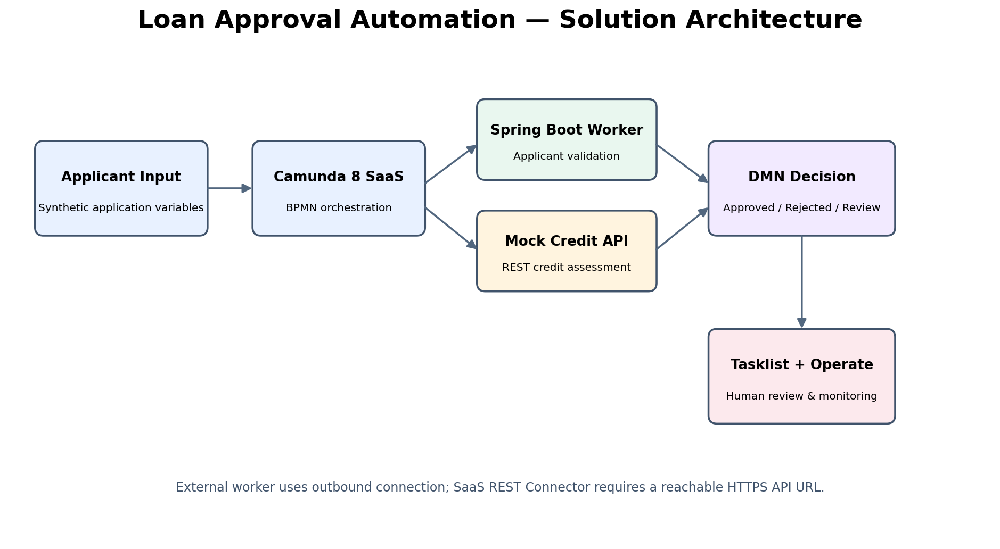
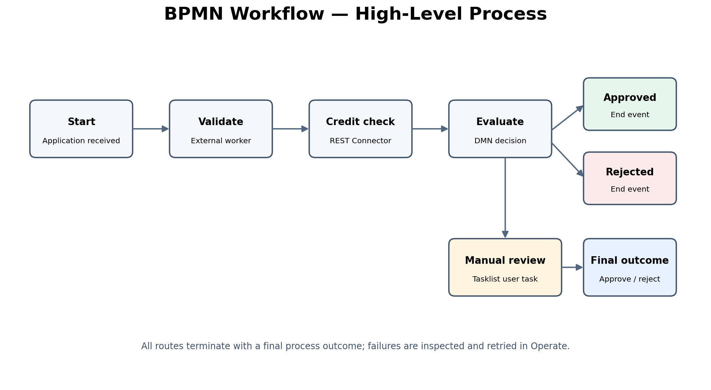
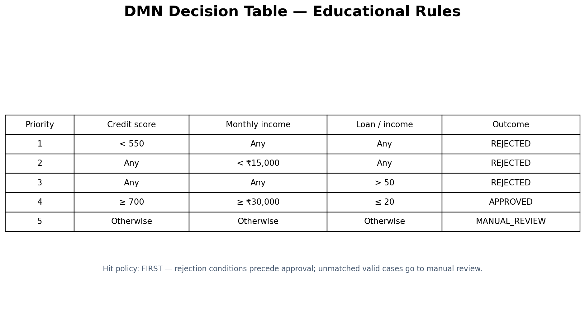
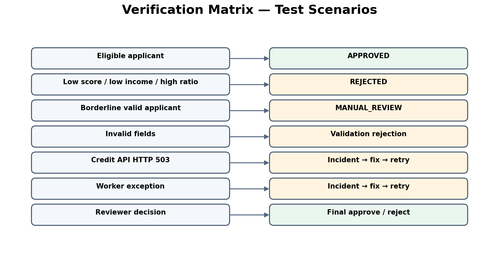

# Lab 1 — Implementation Report

**Submitted by:** Shivam Kumar Jha  
**Register Number:** RA2411056010039

> Complete the **Actual execution evidence** section only after running the project on your Camunda SaaS cluster. Do not claim tests passed until you have executed them.

## 1. Objective

Implement an end-to-end loan approval workflow using Camunda 8 with BPMN orchestration, DMN decisions, an external Java/Spring Boot worker, a REST Connector, process variables, human review, monitoring, and incident recovery.

## 2. Architecture

The BPMN process validates the application through an external worker, calls a synthetic credit-assessment API through the REST Connector, evaluates the deployed DMN table, and either ends as approved/rejected or creates a Tasklist review task. Operate is used to inspect execution and failures.

## 3. Business rules

The decision table returns REJECTED for a credit score below 550, monthly income below INR 15,000, or loan-to-income ratio above 50. It returns APPROVED when credit score is at least 700, income is at least INR 30,000, and loan-to-income ratio is at most 20. All remaining structurally valid applications go to MANUAL_REVIEW. These are educational rules only.

## 4. Implementation components

- BPMN: `bpmn/loan-approval.bpmn`
- DMN: `dmn/loan-eligibility.dmn`
- Camunda Form: `forms/loan-review-form.form`
- External worker and mock REST API: `src/main/java/`
- Test fixtures: `test-data/`

## Visuals

These are authored explanatory diagrams. They do not represent live screenshots from Camunda SaaS.

## 5. Actual execution evidence

| Test | Expected outcome | Actual outcome | Evidence filename |
|---|---|---|---|
| Approval | Approved end event | TO BE COMPLETED | TO BE COMPLETED |
| Rejection | Rejected end event | TO BE COMPLETED | TO BE COMPLETED |
| Manual review | Tasklist task, then chosen route | TO BE COMPLETED | TO BE COMPLETED |
| Worker failure recovery | Incident resolved and job retried | TO BE COMPLETED | TO BE COMPLETED |
| REST API failure recovery | Connector incident resolved and job retried | TO BE COMPLETED | TO BE COMPLETED |

## 6. Limitations

The credit API and score are simulated. The rule thresholds are educational assumptions. A public HTTPS tunnel is needed when the API runs locally and the REST Connector executes in Camunda SaaS. No real customer or financial data should be used.

## 7. Conclusion

Complete this section after deployment. Summarize which scenarios executed successfully, any issues encountered, and how incidents were recovered.
